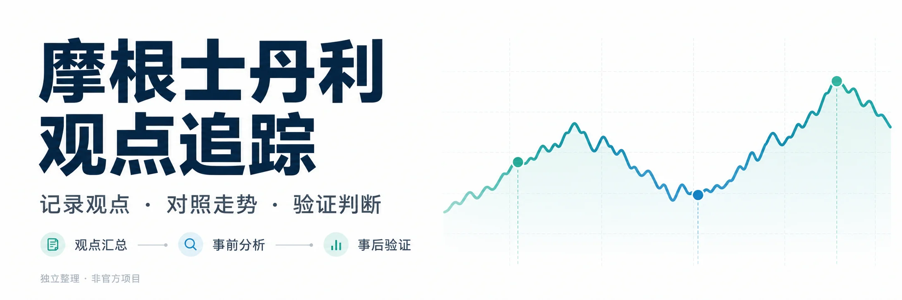

# 研迹 · 大摩观点追踪

**把观点放回它提出的时间。**

本项目按时间整理摩根士丹利相关研究观点，对照股票、指数及行业参考基准的实际走势，观察观点提出前市场已经如何变化，以及提出后是否兑现。项目独立整理，与摩根士丹利及视频上传者无隶属关系，不代表官方认可。

## 四个工作区

- **观点汇总**：按标的查看观点摘要、态度、日期依据、行情与公开来源。
- **事前分析**：对照观点提出前20、40、120个交易日的走势，观察顺势、逆势与方向判断之间的关系。相关性不能证明研究动机。
- **事后验证**：分别查看截至观察日的表现及按原期限的兑现情况，保留实际日期、价格、原观点和出处。
- **会议摘要**：展示标题、日期、频道、重点观点与公开来源链接，不提供ASR转写明细。

## 怎样理解统计

观点按稳定ID追踪；复合标的的关联不会抬高唯一观点总数。态度、股价方向、相对基准与目标价达成是不同口径。没有明确期限的记录按已说明的上下文或默认期限处理；未到原期限的结果属于进展观察。

资料可能来自未核听会议转写、频道解读、研报整理及第三方摘要，归属、日期和证券身份存在不确定性。本项目的样本不代表摩根士丹利全部研究或投资业绩，涨跌一致性不能直接代表完整评级或投资策略的表现。

## 数据与页面

本仓库仅保存经过清洗的静态发布成品。首页读取轻量索引，选中标的后加载对应的观点与行情；事前、事后和会议摘要分别按需读取。所有页面使用同一批次的研究和行情快照，实际截止日以页面及 `site-manifest.json` 为准。

不包含原始PDF、音视频、ASR全文、内部证据或本机文件路径，也不提供明细导出入口。浏览器已经加载的公开数据仍可被读取，移除下载按钮不是访问控制。

GitHub Pages 尚未启用。启用后可通过公网入口访问；本地预览需使用HTTP服务，例如在仓库目录运行 `python3 -m http.server 8000` 后访问 `http://127.0.0.1:8000/`。

## 纠错与资料权利

发现日期、观点归属、标的映射或统计错误，可通过 [Issues](https://github.com/soulpower/ms-research-trace/issues) 提交具体页面、观点ID及问题说明。权利人如有异议，也可联系维护者核查；请勿在公开Issue提交敏感个人资料。

文字整理、页面代码和第三方资料的权利应分别判断。本仓库不因公开展示而授予任何第三方研报、视频或行情数据的再分发许可。内容仅供资料研究，不构成投资建议或收益承诺。

## 更新方式

资料整理与核验在独立研究工作区完成。核验通过后生成公开发布包，检查禁止字段、文件路径、观点ID和页面行为，再同步到本仓库。本仓库不读取研究工作区或运行原始资料分析。
